# تمرین دوم: نمودار و مقایسهٔ پیچیدگی زمانی

هدف این تمرین، دیدن تفاوت رشد الگوریتم‌هاست: اگر اندازهٔ ورودی بیشتر شود، تعداد گام‌های لازم چقدر تغییر می‌کند؟ ابتدا نمودارهای هشت مرتبهٔ رایج را مقایسه می‌کنیم؛ سپس برای هر مرتبه یک الگوریتم، مثال عددی، پیاده‌سازی و فلوچارت می‌بینیم.

## مفهوم پیچیدگی زمانی

پیچیدگی زمانی `Time Complexity` رشد تعداد عملیات را بر حسب اندازهٔ ورودی `Input Size` توصیف می‌کند. متغیر `n` در مثال‌های فهرستی تعداد اعضاست؛ در ضرب ماتریس، تعداد سطر یا ستون هر ماتریس را نشان می‌دهد. دسترسی اندیسی، مقایسه، جمع و ضرب عددی را در مدل شمارش این تمرین یک عملیات با هزینهٔ ثابت در نظر می‌گیریم.

نماد کران بالا `Big O` می‌گوید برای ورودی‌های به‌اندازهٔ کافی بزرگ، رشد زمان از یک تابع، تا ضریب ثابت، بیشتر نمی‌شود. نماد تتا `Theta` مرتبهٔ رشد دقیق را با کران بالا و پایین نشان می‌دهد. مثلاً تابع زیر هم کران بالای درجهٔ دو دارد و هم مرتبهٔ دقیق درجهٔ دو؛ جملهٔ درجهٔ دو با بزرگ‌شدن ورودی غالب می‌شود.

```text
T(n) = 3n² + 5n + 2
T(n) ∈ O(n²)
T(n) ∈ Θ(n²)
```

قرارداد مقایسه: جدول‌ها از نماد `Θ` برای مرتبهٔ دقیق استفاده می‌کنند و تحلیل مثال‌ها بر اساس بدترین حالت `Worst Case` است. پایهٔ لگاریتم در نمودارها دو است؛ تغییر پایهٔ ثابت تنها یک ضریب ثابت به تابع اضافه می‌کند.

## ترتیب از سریع‌ترین به کندترین

ترتیب زیر برای **نرخ رشد در ورودی‌های به‌اندازهٔ کافی بزرگ** است. هرچه تابع آهسته‌تر رشد کند، افزایش ورودی کار کمتری به الگوریتم تحمیل می‌کند.

```text
Θ(1) < Θ(log n) < Θ(n) < Θ(n log n) < Θ(n²) < Θ(n³) < Θ(2ⁿ) < Θ(n!)
```

توضیح رتبه‌ها: ثابت، لگاریتمی، خطی، خطی‌لگاریتمی، درجهٔ دو، درجهٔ سه، نمایی و فاکتوریلی. زمان واقعی یک اجرا به ضرایب ثابت، نوع عملیات و پیاده‌سازی هم وابسته است؛ از یکسان‌بودن مرتبهٔ دو برنامه، زمان یکسان نتیجه نمی‌شود.

نکتهٔ اندازه‌های کوچک: همین ترتیب ممکن است در چند مقدار کوچک برقرار نباشد. برای نمونه، در اندازهٔ چهار، تابع فاکتوریلی از تابع درجهٔ سه کوچک‌تر است؛ با بزرگ‌ترشدن ورودی، فاکتوریلی از آن پیشی می‌گیرد. مقایسهٔ مرتبه‌ها به رفتار رشد توجه دارد.

```text
n = 4:  n! = 24 < n³ = 64
n = 8:  n! = 40320 > n³ = 512
```

| رتبهٔ رشد | نام مرتبه | مرتبهٔ زمانی | مثال الگوریتم | معنای اندازه |
|---|---|---|---|---|
| جایگاه 1 | ثابت | `Θ(1)` | دسترسی مستقیم به عضو اول | تعداد اعضای فهرست |
| جایگاه 2 | لگاریتمی | `Θ(log n)` | جست‌وجوی دودویی | تعداد اعضای فهرست مرتب |
| جایگاه 3 | خطی | `Θ(n)` | یافتن بیشینه با پیمایش | تعداد اعضای فهرست |
| جایگاه 4 | خطی‌لگاریتمی | `Θ(n log n)` | مرتب‌سازی ادغامی | تعداد اعضای فهرست |
| جایگاه 5 | درجهٔ دو | `Θ(n²)` | مرتب‌سازی انتخابی | تعداد اعضای فهرست |
| جایگاه 6 | درجهٔ سه | `Θ(n³)` | ضرب معمولی دو ماتریس مربعی | تعداد سطر یا ستون هر ماتریس |
| جایگاه 7 | نمایی | `Θ(2ⁿ)` | بررسی همهٔ زیرمجموعه‌ها برای مجموع هدف | تعداد اعضای فهرست |
| جایگاه 8 | فاکتوریلی | `Θ(n!)` | پیمایش همهٔ ترتیب‌های کارهای متمایز | تعداد کارهای متمایز |

## نمودارهای رشد زمانی

روش رسم: برای هر مرتبه، تابع نماینده با ضریب یک رسم شده است. محور افقی اندازهٔ ورودی و محور عمودی مقدار تابع رشد است. این مقدار، واحد قراردادی کار است؛ نوت‌بوک همهٔ مقدارها و شکل‌ها را از روی فرمول‌ها محاسبه می‌کند.

### نمودار کلی هشت مرتبه

تصویر زیر از مقیاس لگاریتمی `Logarithmic Scale` در محور عمودی استفاده می‌کند تا هم تابع ثابت و هم تابع فاکتوریلی دیده شوند. فاصله‌های عمودی برابر در این مقیاس، نسبت‌های برابر را نشان می‌دهند. این مقیاس ترتیب مقدار تابع‌ها را تغییر نمی‌دهد.

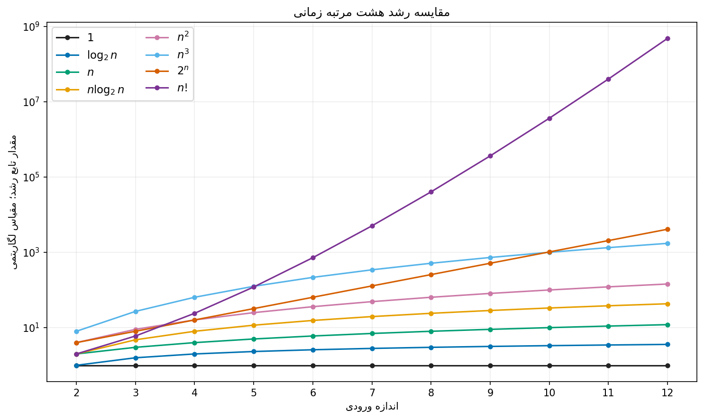

### نمودار مرتبه‌های کم‌رشد و چندجمله‌ای

تصویر دوم دو نمای نزدیک‌تر دارد: سمت چپ ثابت تا خطی‌لگاریتمی و سمت راست خطی تا درجهٔ سه. در سمت چپ، خطی‌لگاریتمی به‌تدریج از خطی فاصله می‌گیرد. در سمت راست، فاصلهٔ درجهٔ سه و درجهٔ دو با افزایش اندازه بیشتر می‌شود.

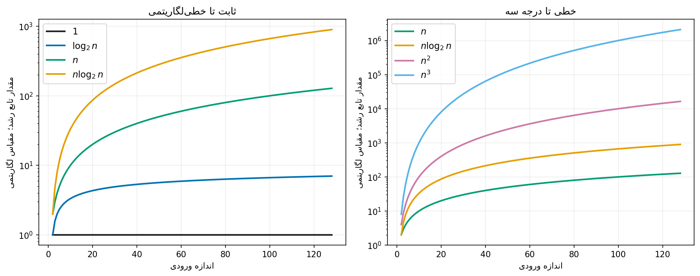

### نمودار اثر دوبرابرشدن ورودی

تصویر سوم نسبت کار در اندازهٔ بیست به اندازهٔ ده را نشان می‌دهد. تابع ثابت تغییری نمی‌کند؛ تابع خطی دوبرابر، درجهٔ دو چهاربرابر و درجهٔ سه هشت‌برابر می‌شود. در تابع نمایی و فاکتوریلی، همین افزایش ورودی جهش بسیار بزرگ‌تری ایجاد می‌کند.

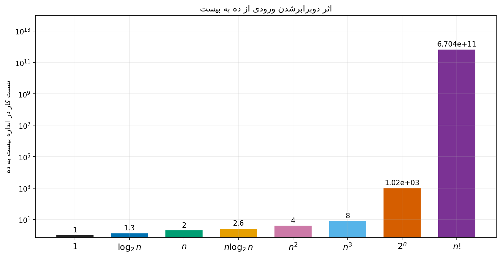

| مرتبه | نسبت کار در اندازهٔ بیست به ده |
|---|---|
| مرتبهٔ ثابت | 1.000 |
| مرتبهٔ لگاریتمی | 1.301 |
| مرتبهٔ خطی | 2.000 |
| مرتبهٔ خطی‌لگاریتمی | 2.602 |
| مرتبهٔ درجهٔ دو | 4.000 |
| مرتبهٔ درجهٔ سه | 8.000 |
| مرتبهٔ نمایی | 1,024.000 |
| مرتبهٔ فاکتوریلی | 670,442,572,800.000 |

### جدول مقدار تابع‌ها

جدول زیر برای دیدن فاصلهٔ عددی مرتبه‌هاست. مقدارهای تابع لگاریتمی و خطی‌لگاریتمی تا دو رقم اعشار گرد شده‌اند؛ سایر مقدارها دقیق‌اند.

| مرتبه | اندازهٔ ۲ | اندازهٔ ۴ | اندازهٔ ۸ | اندازهٔ ۱۶ |
|---|---|---|---|---|
| مرتبهٔ ثابت | 1 | 1 | 1 | 1 |
| مرتبهٔ لگاریتمی | 1.00 | 2.00 | 3.00 | 4.00 |
| مرتبهٔ خطی | 2 | 4 | 8 | 16 |
| مرتبهٔ خطی‌لگاریتمی | 2.00 | 8.00 | 24.00 | 64.00 |
| مرتبهٔ درجهٔ دو | 4 | 16 | 64 | 256 |
| مرتبهٔ درجهٔ سه | 8 | 64 | 512 | 4,096 |
| مرتبهٔ نمایی | 4 | 16 | 256 | 65,536 |
| مرتبهٔ فاکتوریلی | 2 | 24 | 40,320 | 20,922,789,888,000 |

## مثال الگوریتم و فلوچارت برای هر مرتبه

راهنمای کدها: همهٔ توابع در `complexity_examples.py` قرار دارند و در `time_complexity_exercises.ipynb` نیز همراه با مثال اجرا می‌شوند. پارامتر اختیاری `stats` شمار عملیات منتخب را ثبت می‌کند. واحد شمارش هر الگوریتم در جدول معرفی شده است؛ عدد شمارنده برای توضیح رشد همان الگوریتم به‌کار می‌رود.

### مرتبهٔ ثابت

معادل انگلیسی این مرتبه، `Constant Time` است. مثال الگوریتم، دسترسی مستقیم به عضو اول با مرتبهٔ `Θ(1)` است.

ایدهٔ الگوریتم: برای خواندن عضو اول یک فهرست غیرتهی، به اندیس صفر مراجعه می‌کنیم. بزرگ‌شدن فهرست تعداد این دسترسی‌ها را بیشتر نمی‌کند.

مثال اجرا:

```python
first_item([7, 2, 9, 4])
```

پاسخ مثال:

```text
7
```

دلیل مرتبه: یک بررسی خالی‌بودن و یک دسترسی مستقیم داریم؛ تعداد گام‌ها با اندازهٔ ورودی رشد نمی‌کند.

رابطهٔ شمارش یا رابطهٔ بازگشتی `Recurrence Relation`:

```text
T(n) = c = Θ(1)
```

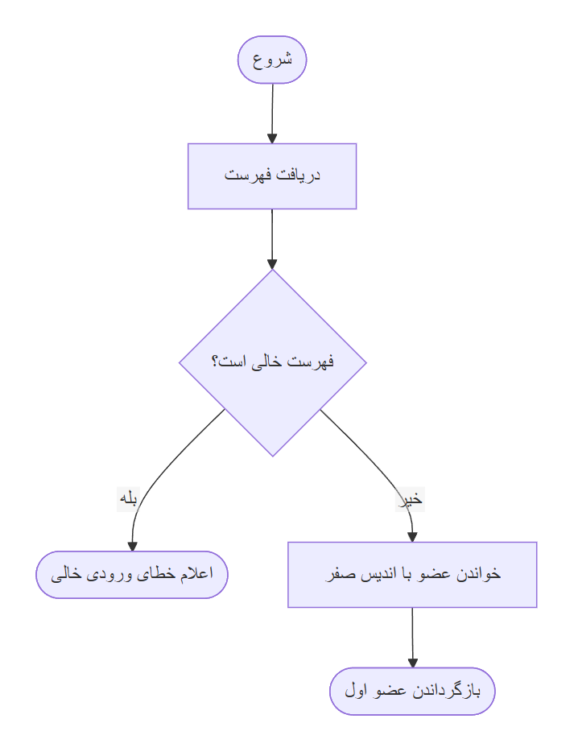

<details>
<summary>متن مرمید فلوچارت</summary>

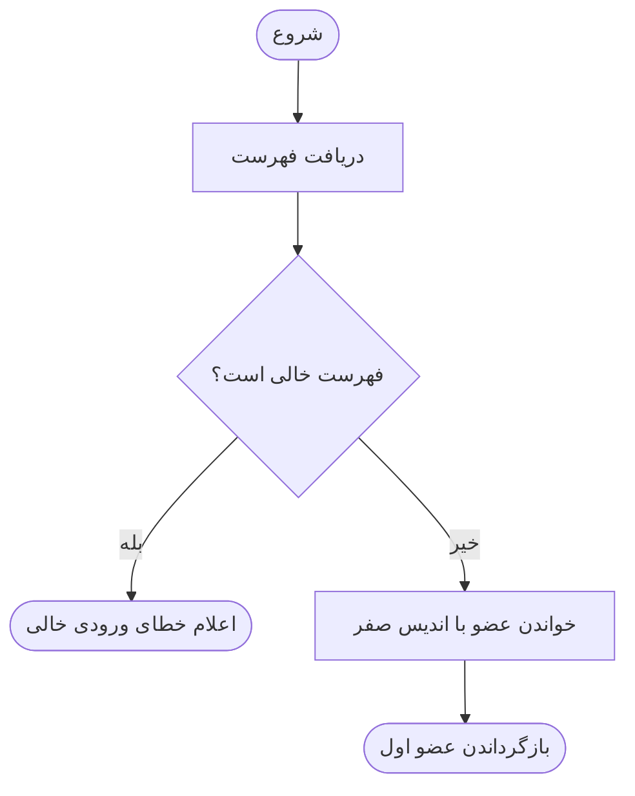

</details>

### مرتبهٔ لگاریتمی

معادل انگلیسی این مرتبه، `Logarithmic Time` است. مثال الگوریتم، جست‌وجوی دودویی با مرتبهٔ `Θ(log n)` است.

ایدهٔ الگوریتم: جست‌وجوی دودویی `Binary Search` در هر گام عضو وسط را با هدف مقایسه می‌کند و یکی از دو نیمه را کنار می‌گذارد. داده‌ها باید از قبل صعودی مرتب باشند.

مثال اجرا:

```python
binary_search([2, 5, 8, 12, 16, 23, 38], 23)
```

پاسخ مثال:

```text
5
```

دلیل مرتبه: پس از هر گام، حدود نصف نامزدها می‌مانند. برای رسیدن از اندازهٔ ورودی به یک عضو، حدود لگاریتمِ اندازه گام لازم است. این مرتبه برای بدترین حالت است؛ پیدا شدن هدف در اولین میانه، زمان ثابت دارد. در حضور تکرار، این نسخه یکی از رخدادها را برمی‌گرداند.

رابطهٔ شمارش یا رابطهٔ بازگشتی `Recurrence Relation`:

```text
n → n/2 → n/4 → ... → 1
T(n) = T(floor(n/2)) + Θ(1) = Θ(log n)
```

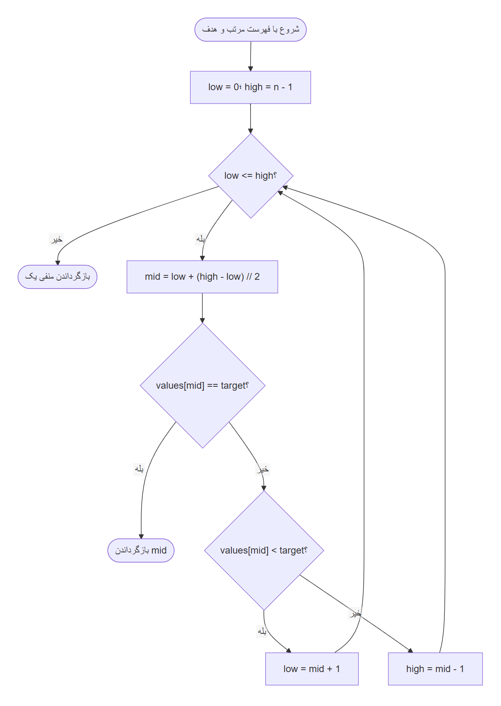

<details>
<summary>متن مرمید فلوچارت</summary>

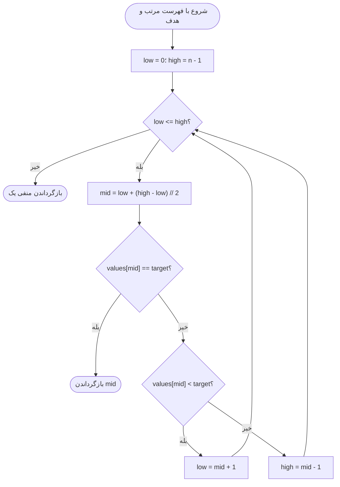

</details>

### مرتبهٔ خطی

معادل انگلیسی این مرتبه، `Linear Time` است. مثال الگوریتم، یافتن بیشینه با پیمایش با مرتبهٔ `Θ(n)` است.

ایدهٔ الگوریتم: عضو اول را بیشینهٔ فعلی می‌گیریم؛ سپس هر عضو بعدی را یک‌بار با آن مقایسه و در صورت نیاز بیشینه را به‌روز می‌کنیم.

مثال اجرا:

```python
linear_max([7, 2, 9, 4])
```

پاسخ مثال:

```text
9
```

دلیل مرتبه: برای یک فهرست غیرتهی، تعداد مقایسه‌ها دقیقاً یک واحد کمتر از تعداد اعضاست. دوبرابرشدن تعداد اعضا، کار اصلی را تقریباً دوبرابر می‌کند.

رابطهٔ شمارش یا رابطهٔ بازگشتی `Recurrence Relation`:

```text
comparisons = n - 1
T(n) = Θ(n)
```

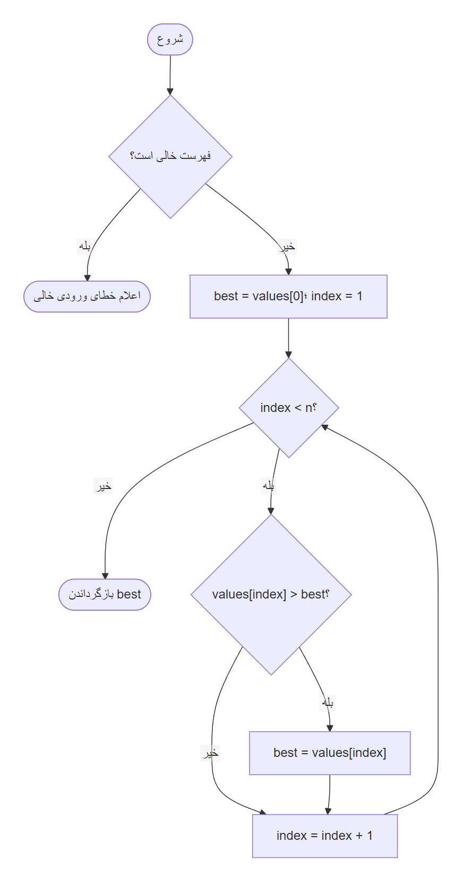

<details>
<summary>متن مرمید فلوچارت</summary>

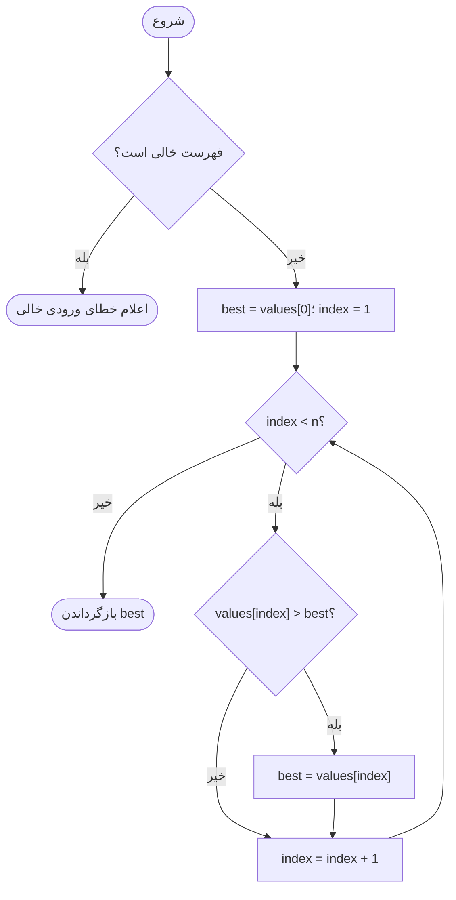

</details>

### مرتبهٔ خطی‌لگاریتمی

معادل انگلیسی این مرتبه، `Linearithmic Time` است. مثال الگوریتم، مرتب‌سازی ادغامی با مرتبهٔ `Θ(n log n)` است.

ایدهٔ الگوریتم: مرتب‌سازی ادغامی `Merge Sort` فهرست را به دو نیمه تقسیم می‌کند، هر نیمه را مرتب می‌کند و نتیجه‌ها را ادغام می‌کند. این روش نمونهٔ تقسیم و حل `Divide and Conquer` است.

مثال اجرا:

```python
merge_sort([7, 2, 9, 4])
```

پاسخ مثال:

```text
[2, 4, 7, 9]
```

دلیل مرتبه: در هر سطحِ تقسیم، مجموع کار ادغام خطی است و حدود لگاریتمِ اندازه سطح داریم. حاصل، رشد خطی‌لگاریتمی است. تابع اصلی یک کپی و یک بافر می‌سازد؛ تابع `sort_range` بازه‌های نیمه‌باز را می‌گیرد و تابع `merge` دو نیمه را در بافر ادغام می‌کند. این نسخه همیشه ادغام را انجام می‌دهد، پس بهترین و بدترین زمان آن از همین مرتبه‌اند.

رابطهٔ شمارش یا رابطهٔ بازگشتی `Recurrence Relation`:

```text
T(n) = 2T(n/2) + Θ(n) = Θ(n log n)
For n = 2^k: buffer writes = n log2(n)
```

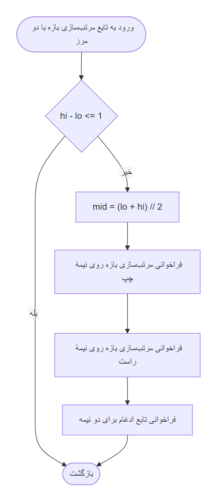

<details>
<summary>متن مرمید فلوچارت</summary>

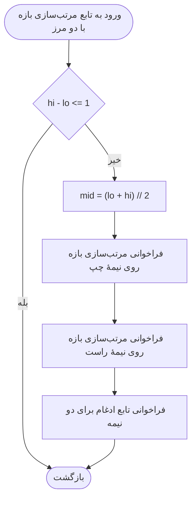

</details>

توضیح تابع کمکی: در هر گام ادغام، کوچک‌ترین عضو ابتدای دو نیمه انتخاب می‌شود؛ سپس اعضای باقی‌مانده منتقل می‌شوند. انتخاب نیمهٔ چپ در حالت برابری، ترتیب اعضای برابر را حفظ می‌کند.

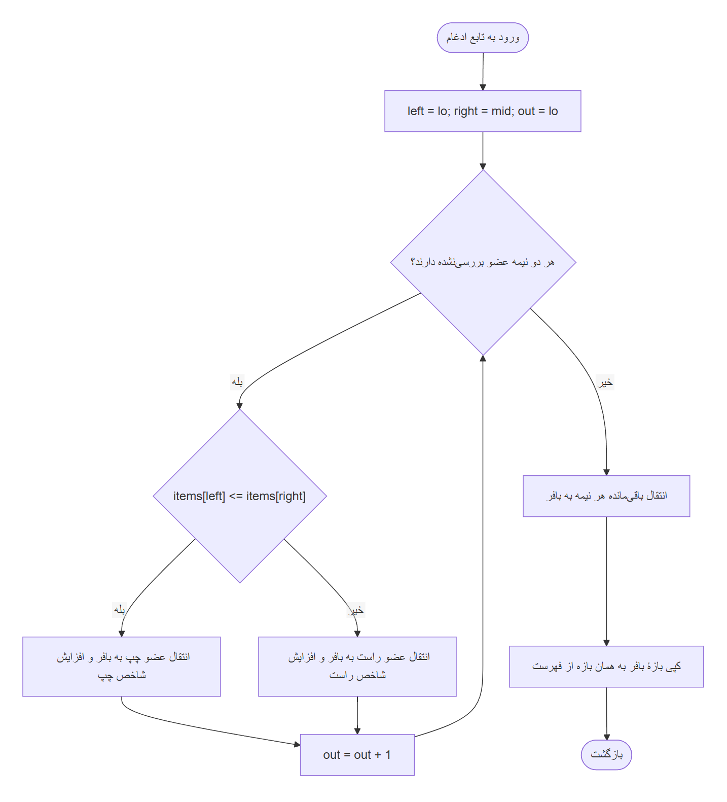

<details>
<summary>متن مرمید فلوچارت</summary>

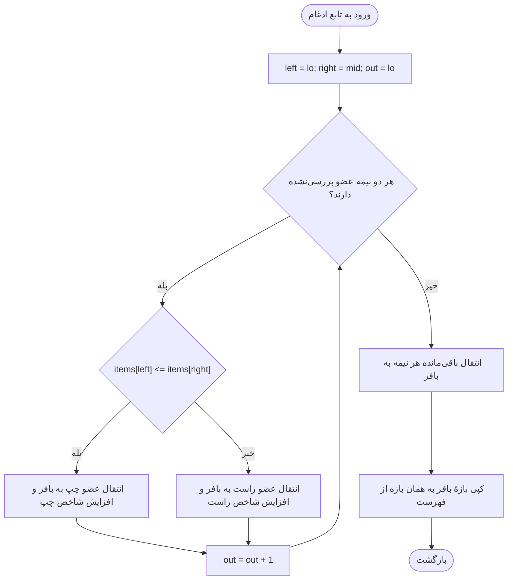

</details>

### مرتبهٔ درجهٔ دو

معادل انگلیسی این مرتبه، `Quadratic Time` است. مثال الگوریتم، مرتب‌سازی انتخابی با مرتبهٔ `Θ(n²)` است.

ایدهٔ الگوریتم: مرتب‌سازی انتخابی `Selection Sort` در هر گذر کوچک‌ترین عضو بخش باقی‌مانده را پیدا می‌کند و در ابتدای آن بخش قرار می‌دهد.

مثال اجرا:

```python
selection_sort([7, 2, 9, 4])
```

پاسخ مثال:

```text
[2, 4, 7, 9]
```

دلیل مرتبه: گذر اول یک واحد کمتر از تعداد اعضا مقایسه دارد، گذر دوم دو واحد کمتر و همین‌طور تا یک مقایسه. جمع این اعداد درجهٔ دو است؛ حتی ورودی مرتب هم همین تعداد مقایسه دارد.

رابطهٔ شمارش یا رابطهٔ بازگشتی `Recurrence Relation`:

```text
comparisons = (n-1) + (n-2) + ... + 1 = n(n-1)/2
T(n) = Θ(n²)
```

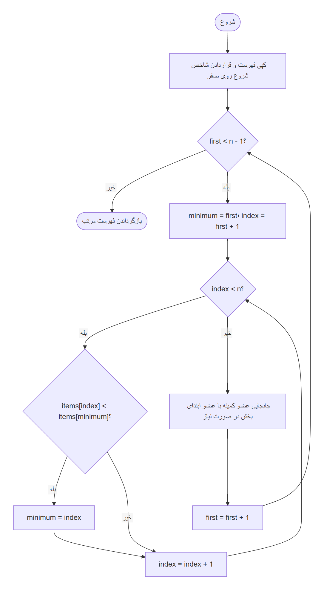

<details>
<summary>متن مرمید فلوچارت</summary>

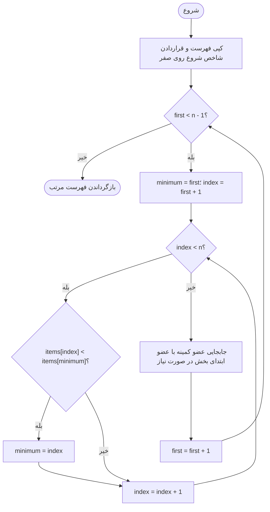

</details>

### مرتبهٔ درجهٔ سه

معادل انگلیسی این مرتبه، `Cubic Time` است. مثال الگوریتم، ضرب معمولی دو ماتریس مربعی با مرتبهٔ `Θ(n³)` است.

ایدهٔ الگوریتم: برای هر سطر ماتریس اول و هر ستون ماتریس دوم، حاصل‌ضرب درایه‌های متناظر را جمع می‌کنیم. سه حلقه روی سطر، ستون و اندیس میانی داریم.

مثال اجرا:

```python
matrix_multiply([[1, 2], [3, 4]], [[5, 6], [7, 8]])
```

پاسخ مثال:

```text
[[19, 22], [43, 50]]
```

دلیل مرتبه: سه حلقه هرکدام به اندازهٔ بعد ماتریس تکرار می‌شوند؛ تعداد ضرب‌های عددی دقیقاً مکعبِ آن بعد است. در این مثال، اندازهٔ ورودیِ نمودار تعداد سطر یا ستون هر ماتریس است و هر ماتریس مربعِ این تعداد درایه دارد.

رابطهٔ شمارش یا رابطهٔ بازگشتی `Recurrence Relation`:

```text
C[i][j] = sum(A[i][k] * B[k][j], k = 0,...,n-1)
scalar multiplications = n × n × n = n³
T(n) = Θ(n³)
```

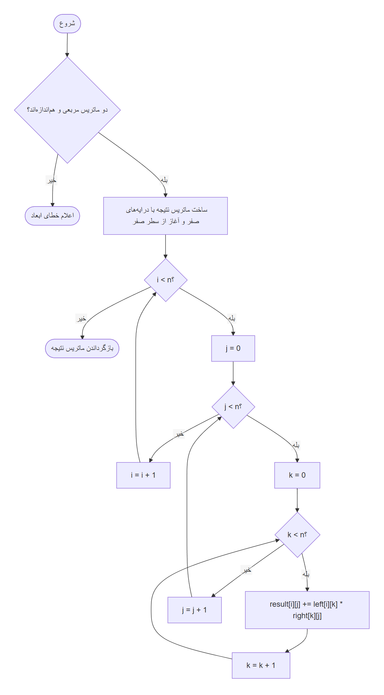

<details>
<summary>متن مرمید فلوچارت</summary>

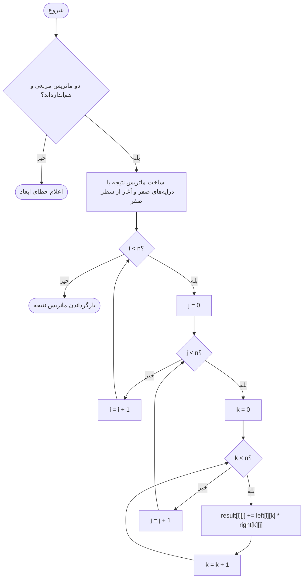

</details>

### مرتبهٔ نمایی

معادل انگلیسی این مرتبه، `Exponential Time` است. مثال الگوریتم، بررسی همهٔ زیرمجموعه‌ها برای مجموع هدف با مرتبهٔ `Θ(2ⁿ)` است.

ایدهٔ الگوریتم: برای هر عضو دو تصمیم داریم: آن را انتخاب کنیم یا کنار بگذاریم. تابع بازگشتی هر دو تصمیم را بررسی می‌کند و در پایان می‌سنجد مجموع اعضای انتخاب‌شده برابر هدف هست یا نه.

مثال اجرا:

```python
count_subset_sums([1, 2, 3], 3)
```

پاسخ مثال:

```text
2
```

دلیل مرتبه: درخت انتخاب در هر سطح دو شاخه دارد؛ در پایان، دو به توان تعداد اعضا برگ و یک واحد کمتر از دو برابرِ آن گره داریم. در کد، مجموع جاری همراه فراخوانی منتقل می‌شود و در برگ، ساختن یا کپی‌کردن زیرمجموعه انجام نمی‌شود. با این کار، هزینهٔ هر گره ثابت می‌ماند. رخدادهای تکراری بر اساس موقعیتشان انتخاب می‌شوند.

رابطهٔ شمارش یا رابطهٔ بازگشتی `Recurrence Relation`:

```text
T(n) = 2T(n-1) + Θ(1) = Θ(2ⁿ)
leaves = 2ⁿ
nodes = 2^(n+1) - 1
```

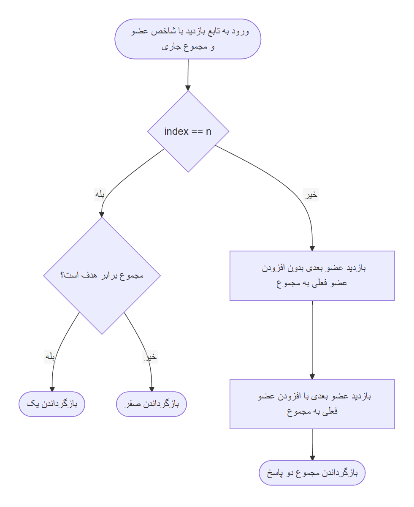

<details>
<summary>متن مرمید فلوچارت</summary>

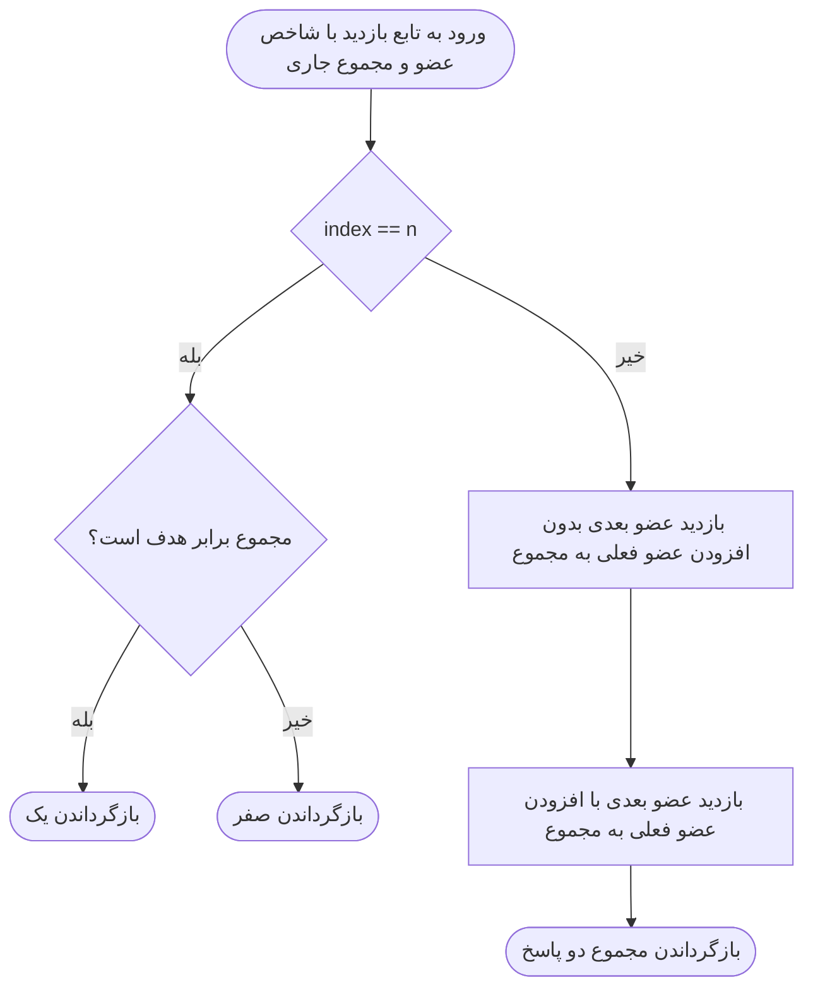

</details>

توضیح پاسخ مثال: دو انتخاب موفق، عضو سوم به‌تنهایی و دو عضو اول با هم هستند.

### مرتبهٔ فاکتوریلی

معادل انگلیسی این مرتبه، `Factorial Time` است. مثال الگوریتم، پیمایش همهٔ ترتیب‌های کارهای متمایز با مرتبهٔ `Θ(n!)` است.

ایدهٔ الگوریتم: برای جایگاه اول هرکدام از کارها را انتخاب می‌کنیم؛ برای جایگاه دوم یکی از کارهای باقی‌مانده را می‌گذاریم و همین روند را ادامه می‌دهیم. با عقب‌گرد `Backtracking` جابجایی قبلی برگردانده می‌شود تا انتخاب بعدی بررسی شود.

مثال اجرا:

```python
count_permutations(['الف', 'ب', 'پ', 'ت'])
```

پاسخ مثال:

```text
24
```

دلیل مرتبه: تعداد ترتیب‌های کامل، حاصل‌ضرب تعداد انتخاب‌ها در جایگاه‌ها و برابر فاکتوریل است. این کد فقط تعداد ترتیب‌ها را می‌شمارد و در هر برگ عدد یک برمی‌گرداند؛ کپی‌کردن کل ترتیب در برگ انجام نمی‌شود. تعداد کل گره‌ها کمتر از سه برابر تعداد برگ‌هاست، پس مرتبهٔ زمان خودِ این نسخه فاکتوریلی است. اگر کارها برچسب‌های یکسان داشته باشند، کد همچنان ترتیب موقعیت‌ها را می‌شمارد.

رابطهٔ شمارش یا رابطهٔ بازگشتی `Recurrence Relation`:

```text
leaves = n × (n-1) × ... × 1 = n!
T(n) = nT(n-1) + Θ(n) = Θ(n!)
```

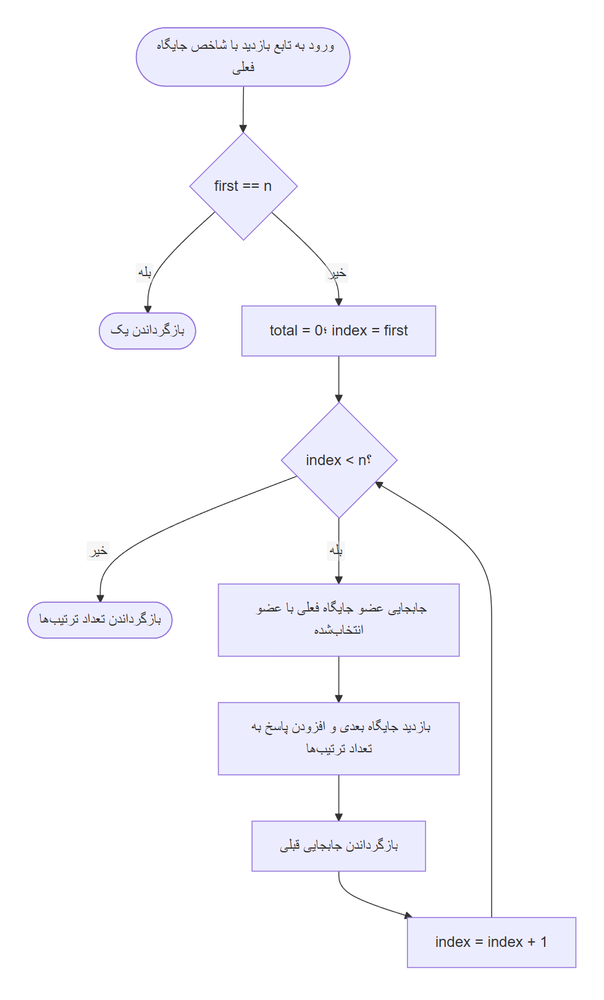

<details>
<summary>متن مرمید فلوچارت</summary>

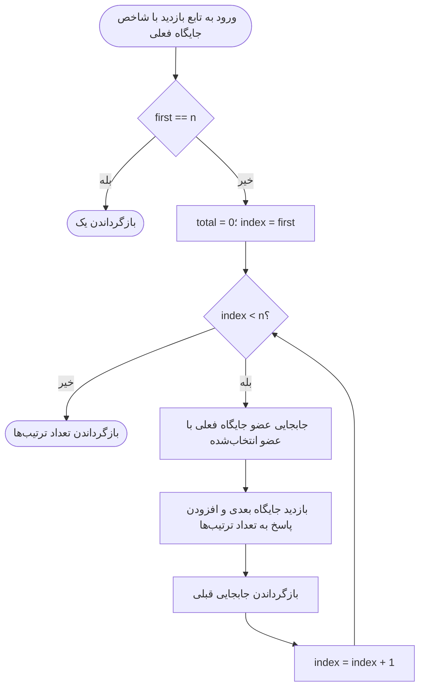

</details>

توضیح تعداد گره‌ها: برای چهار کار، مجموع گره‌های سطوح مختلف برابر یک به‌علاوهٔ چهار به‌علاوهٔ دوازده به‌علاوهٔ بیست‌وچهار به‌علاوهٔ بیست‌وچهار است؛ حاصل، شصت‌وپنج می‌شود.

## بررسی عملی تعداد گام‌ها

آزمایش شمارش، فرمول‌ها را روی خود کد بررسی می‌کند: جست‌وجو با هدفی بزرگ‌تر از تمام اعضا به انتهای مسیر می‌رود؛ ادغامی روی اندازه‌های توان دو سنجیده می‌شود؛ زیرمجموعه‌ها و جایگشت‌ها همهٔ برگ‌های درخت انتخاب را می‌بینند.

| الگوریتم | واحد شمارش | اندازهٔ ۲ | اندازهٔ ۴ | اندازهٔ ۸ |
|---|---|---|---|---|
| دسترسی مستقیم به عضو اول | خواندن عضو | 1 | 1 | 1 |
| جست‌وجوی دودویی | گام جست‌وجو | 2 | 3 | 4 |
| یافتن بیشینه با پیمایش | مقایسهٔ عضو با بیشینه | 1 | 3 | 7 |
| مرتب‌سازی ادغامی | نوشتن عضو در بافر | 2 | 8 | 24 |
| مرتب‌سازی انتخابی | مقایسه برای انتخاب کمینه | 1 | 6 | 28 |
| ضرب معمولی دو ماتریس مربعی | ضرب دو درایه | 8 | 64 | 512 |
| بررسی همهٔ زیرمجموعه‌ها برای مجموع هدف | بررسی برگ درخت انتخاب | 4 | 16 | 256 |
| پیمایش همهٔ ترتیب‌های کارهای متمایز | بررسی یک ترتیب کامل | 2 | 24 | 40,320 |

تفسیر جدول: در جست‌وجوی دودویی، افزایش اندازه از چهار به هشت فقط یک گام اضافه می‌کند. بیشینه تقریباً دوبرابر کار دارد؛ مقایسه‌های انتخابی تقریباً چهاربرابر و ضرب‌های ماتریسی دقیقاً هشت‌برابر می‌شوند. برگ‌های زیرمجموعه از شانزده به دویست‌وپنجاه‌وشش و ترتیب‌های کامل از بیست‌وچهار به چهل‌هزاروسیصدوبیست می‌رسند.

نکتهٔ دو مثال جست‌وجوی کامل: در مثال زیرمجموعه‌ها، تعداد حالت‌هایی را می‌خواهیم که مجموعشان به هدف برسد. در مثال جایگشت‌ها، پیمایش همهٔ ترتیب‌ها برای نشان‌دادن درخت انتخاب نوشته شده است؛ محاسبهٔ صرف تعداد ترتیب‌ها با فرمول فاکتوریل به پیمایش همهٔ آن‌ها نیاز ندارد.

## جمع‌بندی مقایسه

نتیجهٔ مقایسه این است که رشد ثابت و لگاریتمی با بزرگ‌شدن ورودی بسیار آهسته می‌ماند؛ خطی و خطی‌لگاریتمی برای ورودی‌های بزرگ رشد ملایم‌تری از درجهٔ دو و سه دارند. رشد نمایی و فاکتوریلی با افزایش کوچک ورودی می‌تواند تعداد حالت‌ها را بسیار زیاد کند. برای انتخاب میان دو راه‌حلِ یک مسئله، هم مرتبهٔ رشد و هم هزینهٔ عملیات آن‌ها را بررسی می‌کنیم.

## راهنمای اجرا

پیش‌نیاز اجرای نوت‌بوک، `Python` نسخهٔ ۳٫۱۲ و بسته‌های `requirements.txt` است. فایل مثال‌ها فقط از کتابخانهٔ استاندارد استفاده می‌کند و مستقل از نوت‌بوک اجرا می‌شود.

بستهٔ `Matplotlib` نمودارها را رسم می‌کند و بسته‌های `arabic-reshaper` و `python-bidi` اتصال حروف و جهت نوشتار برچسب‌های فارسی را آماده می‌کنند. محیط `JupyterLab` برای بازکردن و اجرای نوت‌بوک به‌کار می‌رود.

دستورهای دریافت و اجرای نوت‌بوک در ویندوز:

```powershell
git clone https://github.com/nonRasa/AlgoE2.git
cd AlgoE2
python -m venv .venv
.\.venv\Scripts\python.exe -m pip install -r requirements.txt
.\.venv\Scripts\python.exe -m jupyterlab time_complexity_exercises.ipynb
```

دستورهای معادل برای لینوکس و مک:

```bash
git clone https://github.com/nonRasa/AlgoE2.git
cd AlgoE2
python3 -m venv .venv
.venv/bin/python -m pip install -r requirements.txt
.venv/bin/python -m jupyterlab time_complexity_exercises.ipynb
```

سپس هسته را بازراه‌اندازی و همهٔ سلول‌ها را از ابتدا اجرا کنید:

```text
Kernel → Restart Kernel and Run All Cells
```

دستور اجرای مثال‌ها و بررسی پاسخ‌ها، بدون نیاز به نصب بستهٔ اضافی:

```bash
python complexity_examples.py
```

فایل‌های اصلی پروژه:

- فایل `README.md` متن آموزشی، نمودارها، مثال‌ها و فلوچارت‌ها را در کنار هم دارد.
- فایل `time_complexity_exercises.ipynb` کدها، رسم نمودارها و بررسی پاسخ‌ها را اجرا می‌کند.
- فایل `complexity_examples.py` پیاده‌سازی هشت الگوریتم و بررسی‌های مستقل آن‌هاست.
- فایل `requirements.txt` نسخهٔ بسته‌های لازم برای اجرای نوت‌بوک را مشخص می‌کند.
- پوشهٔ `figures` نمودارهای رسم‌شده و تصویر فلوچارت‌ها را نگه می‌دارد.

تصویر فلوچارت‌ها هم در راهنما و هم به‌صورت پیوست داخل نوت‌بوک قرار دارد؛ متن `Mermaid` هر فلوچارت برای ویرایش در بخش مربوط به همان الگوریتم آمده است.
